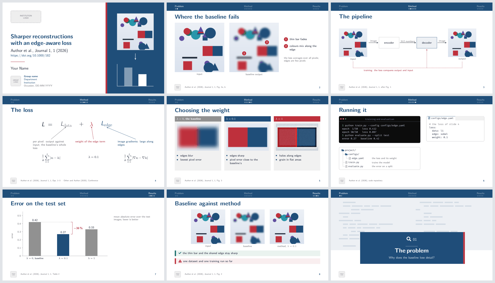

# Beamer talk template

A LaTeX Beamer template for research talks: 16:9 slides drawn on a millimetre grid, a citation in every footer, section dividers that each ask one question, and speaker notes with a time range per slide, built into a PDF of their own. An example talk of about eight minutes shows each part; replace its slides with yours.



## Start a talk

1. Click **Use this template** on GitHub, or copy this folder.
2. Replace the two placeholder logos in `presentation/assets/`: `logo-institution` (title and closing slides) and `logo-group` (title slide and footer), as `.pdf`, `.png` or `.jpg`.
3. Set the title, subtitle, presenter, institute and date in `presentation/main.tex`, and for a talk on a paper its DOI.
4. Put your institution's colours into the RGB values at the top of `presentation/beamerthemetalk.sty`.
5. Write the timed outline in `OUTLINE.md`, then replace the example slides in `presentation/slides/`.
6. Build, check that every note fits, and look at every page.

[SLIDE-STYLE.md](SLIDE-STYLE.md) describes how the slides are meant to look and read: one message per slide, carried by a drawing, a figure or an example.

## Files

| Path | Content |
|---|---|
| `presentation/main.tex` | Entry point: title, subtitle, DOI, presenter, institute, date, the section files |
| `presentation/beamerthemetalk.sty` | Theme: colours, fonts, headline, footer, frame titles, blocks, code and terminal windows, folder trees, section dividers |
| `presentation/slides/macros.tex` | Drawing helpers: parts of figures, numbered explanations, strips, cards, labels |
| `presentation/slides/*.tex` | One file per section; `00-title.tex` holds the title slide and the outline, `04-closing.tex` the closing slide, `05-appendix.tex` the appendix |
| `presentation/speaker-notes.tex` | Builds the speaker notes from `main.tex` |
| `presentation/assets/` | The two placeholder logos and the example figure |
| `presentation/tools/` | `make_placeholders.py` draws the placeholders, `check_notes.py` checks the speaker notes, `contact_sheet.py` renders pages to one image |
| `presentation/build.ps1`, `presentation/build.sh`, `presentation/.latexmkrc` | Builds: PowerShell, POSIX shell, latexmk |
| `OUTLINE.md`, `SOURCES.md`, `THIRD-PARTY-NOTICES.md` | The timed outline, the sources of each slide, and the material by others with its licence; filled in for the example talk |

## Build

From the `presentation` folder, in PowerShell:

```powershell
.\build.ps1
.\build.ps1 speaker-notes
```

or in a POSIX shell:

```sh
./build.sh
./build.sh speaker-notes
```

The slides go to `build/main.pdf` and the speaker notes to `build/speaker-notes.pdf`. Each build runs XeLaTeX three times, because the section dividers place their graphics relative to the page, and then lists the layout warnings: overfull boxes, missing characters and undefined references. `latexmk` works too, with the included `.latexmkrc`.

Requirements: XeLaTeX (tested with MiKTeX 25.12) with beamer, TikZ, tcolorbox, listings, fontawesome5, booktabs, tabularx and colortbl. Text is set in Latin Modern Sans, which ships with TeX. Code is set in [FiraCode Nerd Font Mono](https://www.nerdfonts.com/font-downloads) when it is installed, and in Latin Modern Mono otherwise. On Overleaf, upload the contents of `presentation/` as a project, without `.latexmkrc` and `build/`, and choose XeLaTeX as the compiler and `main.tex` as the main document.

The tools need Python 3 with PyMuPDF and Pillow: `pip install pymupdf pillow`.

## Editing

- **Title, presenter, date:** `\title{}`, `\subtitle{}`, `\paperdoi`, `\author{}`, `\institute{}` and `\date{}` in `main.tex`, and the PDF's own title in `\hypersetup`. Break a long title at its phrases with `\\`; the title slide sets up to three lines at 16.5 pt. The title's text block is anchored at the presenter's name, so a longer title grows upwards and the name stays in place. For a talk on a paper, put the paper's citation into `\subtitle{}` and its DOI into `\paperdoi`: the title slide shows `https://doi.org/` and the DOI under the citation, as a link. Leave `\paperdoi` empty for no DOI line.
- **Logos:** `\institutionlogo` and `\grouplogo` in the theme name the files, without extension.
- **Colours:** the theme names its colours by meaning, and each keeps that meaning on every slide: `primary` for the subject (the method, the model, the tool) and for titles, `accent` for what to look at (a decision, a problem, a numbered marker), `ink` for body text and fixed inputs such as data, `good` for what works, and greys (`grey`, `greymid`, `greylight`, `greypale`) for secondary text, baselines and guides. Cards and panels use the tints `primarytint`, `accenttint`, `goodtint` and `inktint`. Every coloured element also has a text label.
- **Sections:** `\section[short name]{title}` names the section in the headline, and `\sectionframe{01}{title}{guiding question}{\faSearch}` draws its divider with a fontawesome5 icon. The outline slide lists the sections with their questions.
- **Slides:** draw each slide in a `tikzpicture[x=1mm,y=1mm]` that starts at y = 0 and stays within `\useasboundingbox (0,0) rectangle (144,-54)`. The theme starts every slide's content 4 mm below the title; add no `\vspace` at the start of a frame and use `[T]` columns.
- **Citations:** a frame's `source={...}` fills its footer, and every footer uses one form. A work is cited by its authors, year and venue: "et al." for three or more authors, "and" for two; a journal by its abbreviation, volume and first page, a conference by its acronym, a preprint by its arXiv number, a book by its title in italics. The figure, equations or section used follow: a reproduced figure adds its licence, as in `Fig.\ 2c (CC BY 4.0)`, and a drawing made after a figure says `after Fig.\ 4f`. Works are joined by ` · `, and a footer of two lines breaks only between works. The full references go on the last appendix slides.
- **Figures:** `\figpart{x}{y}{file}{image width}{x0}{y0}{x1}{y1}{width}` shows the pixel box (x0, y0)–(x1, y1) of an image that is `image width` pixels wide, scaled to `width` mm, with its top-left corner at (x, y). Afterwards `{\fpx{px}}` and `{\fpy{py}}` give the slide position of an image pixel, to place a marker or a label. Number what the audience should look at with `\node[number mark] at (x,y) {1};` and repeat the number in the explanation with `\markeditem{1}{text}`, or in running text with `\numbermark{1}`. A figure under a licence without adaptations (ND) stays unmodified: labels and markers go beside it.
- **Strips and cards:** `\warnstrip{y}{text}` draws a red strip for a catch and `\goodstrip{y}{text}` a green one for what holds; `\cardhead{x}{y}{width}{colour}{label}` draws a card's head, the style `card text` sets its body, and `\cardbullet{text}` sets one line of it with the theme's bullet.
- **Boxes:** `infoblock` (information), `warnblock` (decisions and warnings), `datablock` (files and data), `goodblock` (what works) and `panel` (untitled); `codefile` shows a file as in an editor, with its path in a tab (Markdown by default, `[style=sh]` for shell, YAML and TOML, `[style=py]` for Python); `terminal` shows commands in a terminal window, with green `$` prompts; `terminalwindow` frames a terminal screenshot; `foldertree` draws a folder structure with `\tdir{depth}{name}{note}` and `\tfile{depth}{name}{note}` rows. A frame with `codefile` or `terminal` needs the `fragile` option.
- **Speaker notes:** `\note{\textbf{1:00--2:00}\par First point.\par Second point.}`: the time range first, then one sentence per line, so that a glance finds the next cue. A backup slide's note starts with `\textbf{If asked}` and adds no time. A slide that builds up in steps attaches its note to the last step, `\note<2>{...}`. A note that is too long is cut off without a warning; `tools/check_notes.py` finds it.
- **Links:** `\slidelink{url}{text}` makes a link in the slides and the same text, without the link, in the speaker notes, whose thumbnails scale a slide but not its links.
- **Title and closing slides:** both are drawn inside their frames, so that the speaker notes show them too. `\titlepanel` in `00-title.tex` draws the panel on their right: replace its drawing with the key figure of your talk, simplified.
- **Appendix:** after `\appendix` the footer numbers slides A1, A2 and so on; give each appendix title the same number, as in `A1\enspace The loss in full`.

## Checks

After every change:

1. Build both PDFs and fix every layout warning that the build lists.
2. Run `python tools/check_notes.py`: every note's last words must appear in the speaker notes, and nothing may run into a notes page's bottom edge.
3. Run `python tools/contact_sheet.py` and look at `build/contact-sheet.png` for spacing, overlaps, sizes and alignment.
4. Compare the slide numbers in `OUTLINE.md` with the footers.

`python tools/make_placeholders.py` draws the placeholder logos and the example figure again.

## Credits

The theme's look follows two earlier designs, which `presentation/beamerthemetalk.sty` reimplements with its own colours, fonts and components:

- [TU Delft presentation](https://www.overleaf.com/latex/templates/tu-delft-presentation/jcxrmnxssdst) by Novanext, an Overleaf template licensed under [CC BY 4.0](https://creativecommons.org/licenses/by/4.0/): plain square blocks, the logo in the footer, and section dividers as a centred box over a band.
- Beamer's Frankfurt theme, part of the [beamer](https://ctan.org/pkg/beamer) class (LaTeX Project Public License 1.3c, or GNU GPL 2 or later): the headline of section names with a dot per frame below each.
